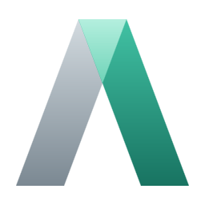
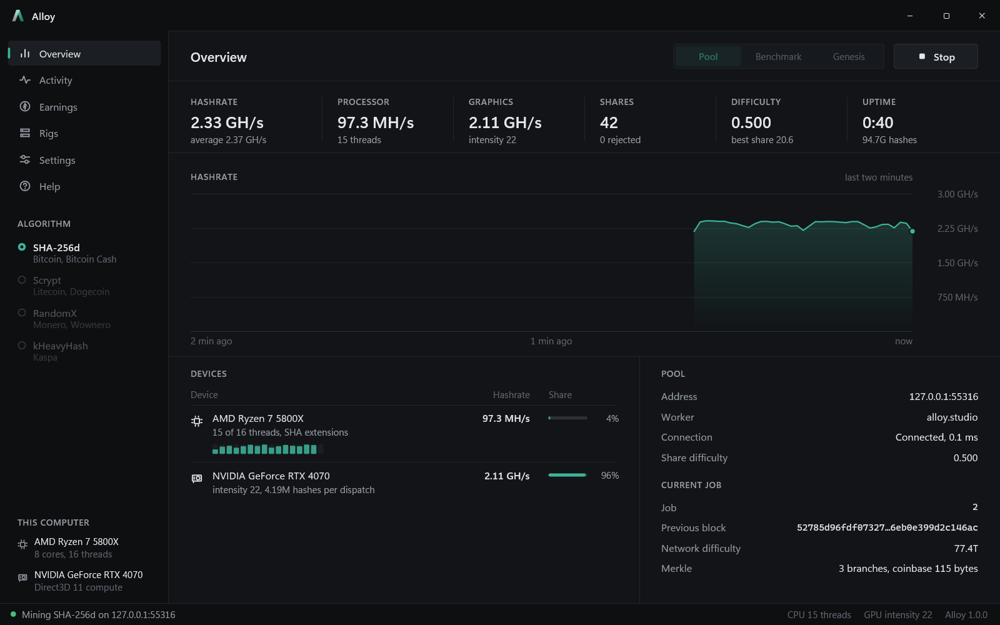
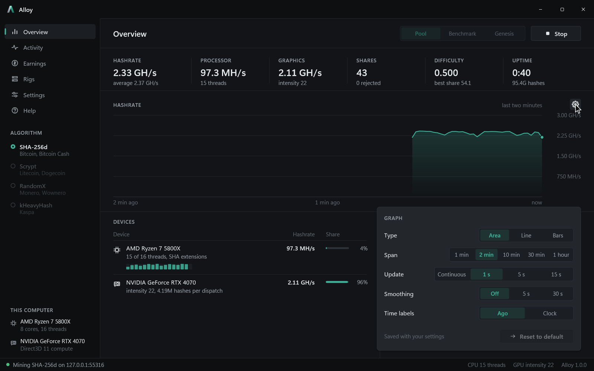
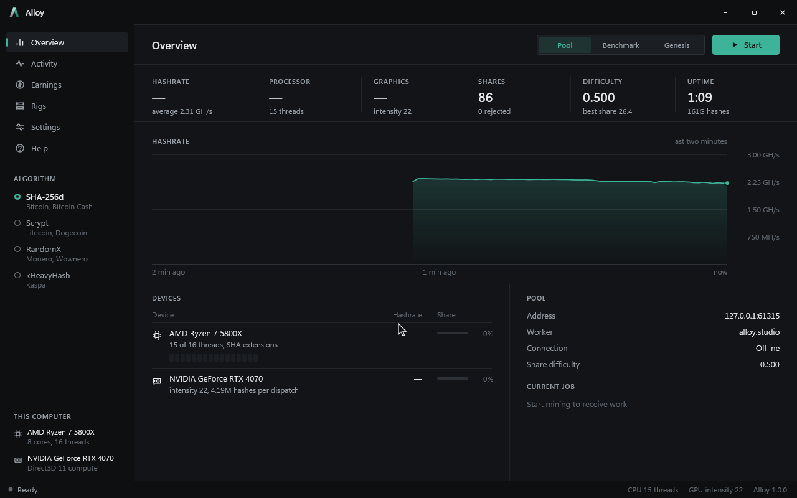
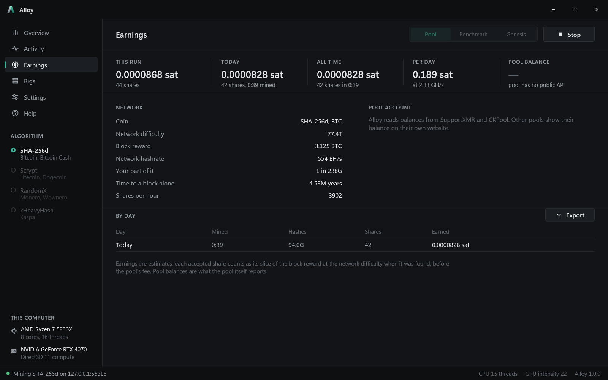
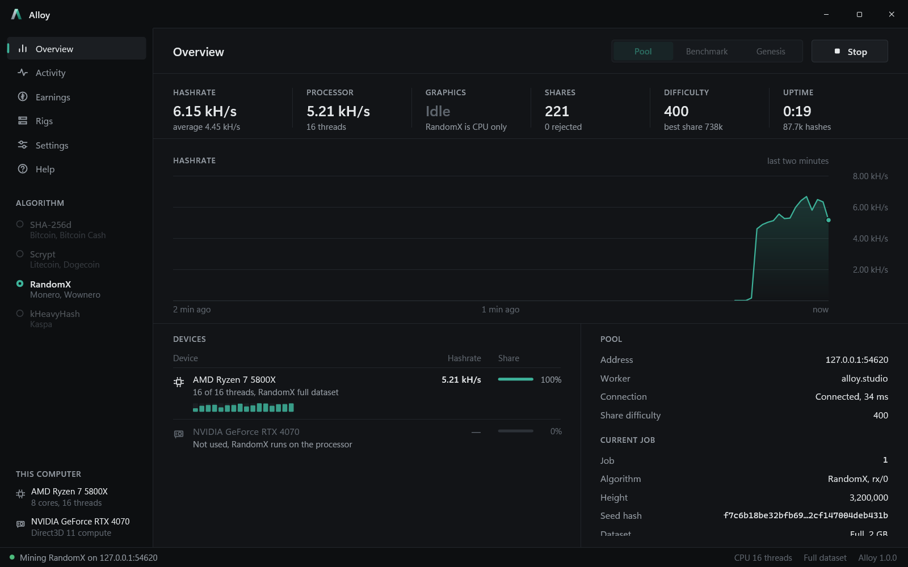
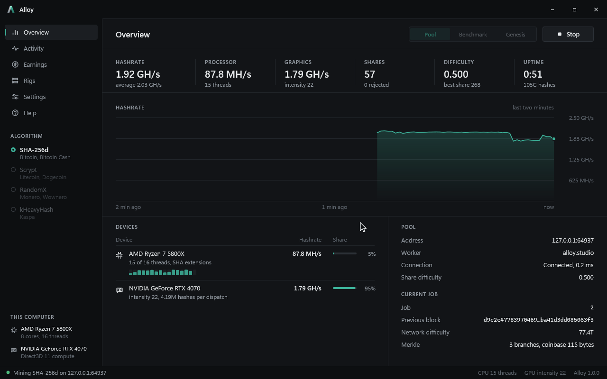
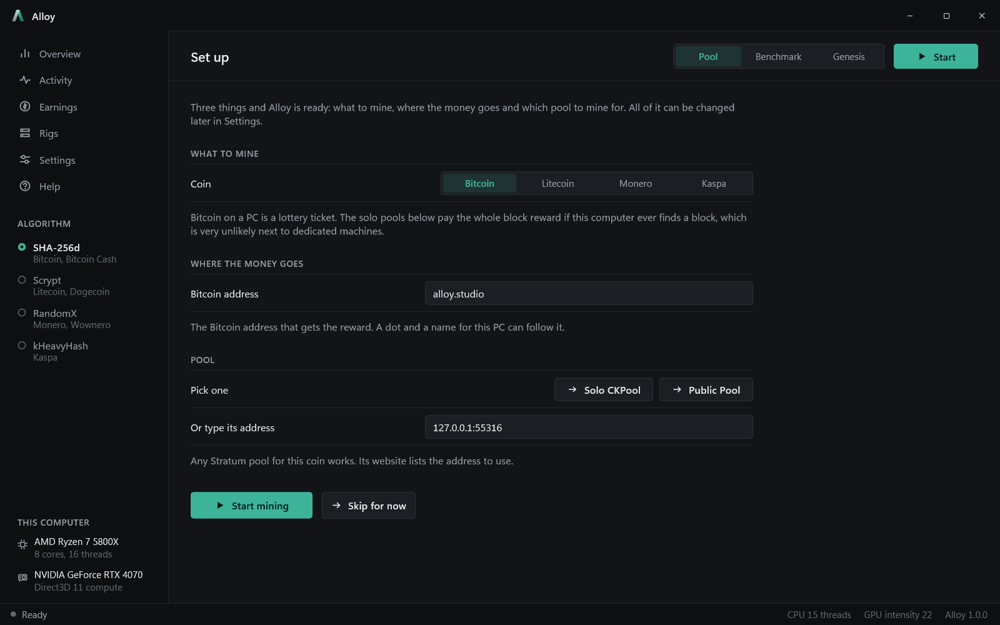
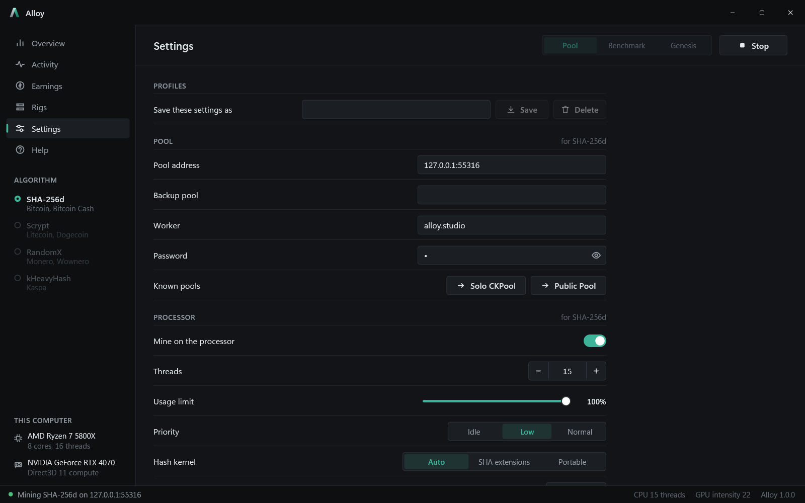

<p align="center"></p>

<h1 align="center">Alloy</h1>

<p align="center">A SHA-256d, scrypt, RandomX and kHeavyHash miner for Windows, written from scratch in C++ with no C runtime.</p>



Alloy mines Bitcoin-style SHA-256d, Litecoin-style scrypt, Monero's RandomX and Kaspa's kHeavyHash on the processor and the graphics card. It talks to pools over Stratum, Stratum V2, Monero's login protocol and the Kaspa bridge dialect, or straight to your own node for solo mining. The hashes, the RandomX virtual machine and its compiler, the secp256k1 and Noise code behind Stratum V2, the pool clients, the GPU kernels, the renderer, the PNG and GIF writers and the JSON reader are all its own code. The only outside pieces are the Windows APIs underneath: Winsock, Schannel, Direct3D 11, DirectComposition, Direct2D and DirectWrite.

## What it does

**Algorithms**

- **SHA-256d** on the processor with the x86 SHA extensions, falling back to a portable kernel, and on the graphics card with a compute shader that skips every round the nonce can't change.
- **Scrypt** (N 1024, r 1, p 1) on the processor with SSE2 or AVX2, and on the graphics card as three kernels that keep every other scratchpad block and recompute the rest, which fits 32,768 hashes in flight.
- **RandomX** with its own Argon2d, Blake2b, AES generators and SuperscalarHash, and the Wownero, ArQmA, Graft, Safex, Yada, Keva and Equilibria variants. Each program is compiled to x86-64 at run time. The 2 GB dataset builds in seconds, light mode needs only 256 MB, and the thread count follows the processor's L3 cache.
- **kHeavyHash** for Kaspa: cSHAKE256, the xoshiro-seeded 64 by 64 matrix with its rank check, and a compute shader that agrees with the processor hash for hash.

**Pools and nodes**

- **Stratum** for SHA-256d and scrypt, with `stratum+ssl://` over Schannel (certificate pinning for pools Windows doesn't trust), extranonce changes, a backup pool after three failed tries and NiceHash support.
- **Stratum V2** at `stratum2+tcp://host:port/authority_key`: the Noise NX handshake over secp256k1 with ElligatorSwift, ChaCha20-Poly1305 framing, and a BIP340 check of the pool's certificate before any work is accepted.
- **Monero's login protocol**, following pools such as MoneroOcean when they switch RandomX coins.
- **Kaspa's Stratum bridge dialect**, both the four-word and the hex job formats.
- **Solo mining** against your own node: `getblocktemplate` for Bitcoin Core (segwit commitment, BIP34 height, cookie or password login) and `get_block_template` for monerod. Alloy builds the coinbase and hands every block it finds back to the node.
- **A test pool** (`--test-pool`) for every algorithm that hands out real-looking work and checks every share, plus a test node and a Stratum V2 server for the test suite.

**Earnings and records**

- An Earnings page with the session's and each day's estimated earnings, the odds of finding a block alone, the pool balance where SupportXMR or CKPool publish it, and the value in USD, EUR, GBP or SEK.
- A history of every day mined, kept across restarts, and CSV export of shares, the log and the daily totals.

**When and how hard to mine**

- Threads, a processor usage limit, priority, kernel choice, GPU intensity, a GPU usage limit and a temperature limit, for all cards or each card on its own.
- Pausing while the computer is in use, on battery, for full-screen apps, for chosen programs, or outside a weekly schedule, and Ctrl+Alt+M to pause from anywhere.
- Profiles that hold every setting, `--profile` and `--set key=value` on the command line, and Tune, which measures thread counts and batch sizes and keeps the fastest.
- A first-run page that asks for the coin, the wallet and the pool.

**Watching**

- A local API and web dashboard, optionally open to the network behind an access token, that can also pause and resume mining.
- A Rigs page that watches other computers running Alloy.
- Tray notifications for rejected shares, pool failover, overheating cards and found blocks.
- A self-test of every kernel and graphics card at start-up, crash reports with a stack trace, and logs kept for two weeks.

**The interface**

- Animates at the display's refresh rate, explains a setting when you rest the cursor on it, undoes any change with Ctrl+Z, works from the keyboard alone, and stops drawing while minimized so the hardware stays on mining.
- The hashrate graph keeps its standard look until you rest the cursor on it; then a gear fades in with the graph's type (area, line or bars), span (a minute to an hour), update rate (continuous, gliding along with the live hashrate, or every 1, 5 or 15 seconds), smoothing and clock or relative time labels.







## Speed

Release build on a Ryzen 7 5800X and an RTX 4070:

| Algorithm | Device | Hashrate |
| --- | --- | --- |
| SHA-256d | 16 threads, SHA extensions | 126 MH/s |
| SHA-256d | 15 threads and the RTX 4070 | 2.43 GH/s |
| Scrypt | 16 threads | 126 kH/s |
| Scrypt | the RTX 4070 | 1.51 MH/s |
| RandomX | 12 threads, full dataset | 5.07 kH/s |
| RandomX | 12 threads, light mode | 426 H/s |
| kHeavyHash | 16 threads | 9.28 MH/s |
| kHeavyHash | the RTX 4070 | 429 MH/s |

Large pages usually make RandomX faster still, because the dataset reads stop missing the TLB. Press Allow next to Large pages in Settings, or run `Alloy.exe --allow-large-pages` once from an administrator terminal, then sign out and back in.







## Building

Open `alloy.sln` in Visual Studio 2022 with the "C++ Clang tools for Windows" component and a current Windows SDK installed, then build `Release|x64`. The executable lands in `build\release\Alloy.exe`. Sources compile in parallel, so a full rebuild takes a few seconds and a one-file change under one.

## Command line

```
Alloy.exe                                   open the window
Alloy.exe --bench [algorithm] [--seconds n] measure the hashrate
Alloy.exe --genesis [--from nonce]          rediscover a genesis block's nonce
Alloy.exe --mine host:port [--user name] [--pass word] [--seconds n]
Alloy.exe --mine http://127.0.0.1:8332 --user address        mine solo against your own node
Alloy.exe --mine stratum2+tcp://host:port/authority_key      mine on a Stratum V2 pool
Alloy.exe --test-pool [--port n] [--difficulty d] [--job-seconds n]
Alloy.exe --tune [algorithm]                find the fastest threads and intensity
Alloy.exe --self-test                       check every kernel and card against known answers
Alloy.exe --profile name --set key=value    open the window with a profile and changes
Alloy.exe --allow-large-pages               let RandomX use large pages

Algorithm --algorithm sha256d|scrypt|randomx|kheavyhash  --dataset full|light
Devices   --threads n  --no-cpu  --gpu  --no-gpu  --adapter n
Limits    --cpu-limit percent  --gpu-limit percent  --intensity 16-26
Kernel    --kernel auto|extensions|portable  --priority idle|low|normal
```

To try pool mining without an account, start a test pool in one terminal and point the window or `--mine` at it:

```
Alloy.exe --test-pool --algorithm randomx --port 3335
Alloy.exe --mine 127.0.0.1:3335 --algorithm randomx
```



## Layout

```
src/base                 the standard library: memory, strings, text, bits, math
                         and the runtime
src/base/containers      list, ring and sort
src/base/system          threads, clock, files, dialogs, processes, console,
                         clipboard, COM and the hardware queries
src/base/formats         JSON, PNG and GIF
src/hash                 SHA-256 with and without the SHA extensions, scrypt,
                         Blake2b, Argon2d, Keccak, cSHAKE and kHeavyHash,
                         ChaCha20-Poly1305 and the RandomX AES generators
src/chain                algorithms, headers, targets, merkle trees, coinbases,
                         wallet addresses and payout scripts, and secp256k1 with
                         ElligatorSwift and BIP340 signatures
src/randomx              SuperscalarHash, the cache and dataset, the virtual
                         machine, an x86-64 assembler and the compilers built on it
src/mine                 the engine that schedules nonces across threads and cards
src/mine/gpu             the Direct3D 11 host for the compute shaders
src/mine/gpu/kernels     the SHA-256d, scrypt and kHeavyHash compute shaders
src/net                  sockets, TLS, HTTP and the Noise handshake
src/pool                 Stratum, Stratum V2, Monero, Kaspa and solo mining, the
                         presets, and the test pool, node and Stratum V2 server
src/render               the Direct2D surface for the window and for captures
src/ui                   the shell, widgets, icons, theme and the mark
src/ui/pages             Overview, Activity, Earnings, Rigs, Settings, Help and
                         the first-run page
src/app                  the window, the mining session, settings and profiles,
                         the history, online lookups, the API and dashboard, rigs,
                         export, tuning, the self-test and the command line
src/app/debug            the headless screenshot and clip recorder
src/tests                the Debug-only test suite
src/version.hh           the version, shared by the code and the resource file
```

`alloy.vcxproj` picks up sources by wildcard and `alloy.vcxproj.filters` mirrors these folders in Solution Explorer. A new folder under `src` needs a matching filter there.

## Tests

A Debug build runs its suite with `Alloy.exe --test`, or one group with `--test kaspa`. It checks SHA-256 against FIPS 180, scrypt and PBKDF2 against RFC 7914, Blake2b against RFC 7693, cSHAKE against SP 800-185, ChaCha20-Poly1305 against RFC 8439, HMAC against RFC 4231, BIP340 signatures and BIP324's ElligatorSwift key exchange against their reference vectors, the Bitcoin and Litecoin genesis blocks, RandomX against its reference programs in both modes, every GPU kernel against the processor, and full sessions on a test pool for every algorithm, solo mining against a node that checks each block in full, and Stratum V2 through the whole handshake. It also covers the schedule, profiles, the history file, the API's access rules, keyboard navigation, undo, and that animated text and hints land on exactly the pixels they rest on.

`Alloy.exe --test online` checks against the real networks instead: a live Kaspa block's header hash and proof of work, signing in and getting jobs from Kaspa, Bitcoin and Monero pools (over TLS too), shares accepted by a Kaspa pool and by the Stratum V2 reference project's hosted pool, and solo templates from a public monerod.

`Alloy.exe --smoke-window shot.png` checks the real window: the custom frame's hit testing, that animations run at the display's refresh rate while mining, and that a hidden or minimized window draws nothing. `Alloy.exe --capture <folder>` records the screenshots and clips above from a headless run.

## About

Made by Leo Hagnesten.
