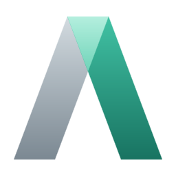
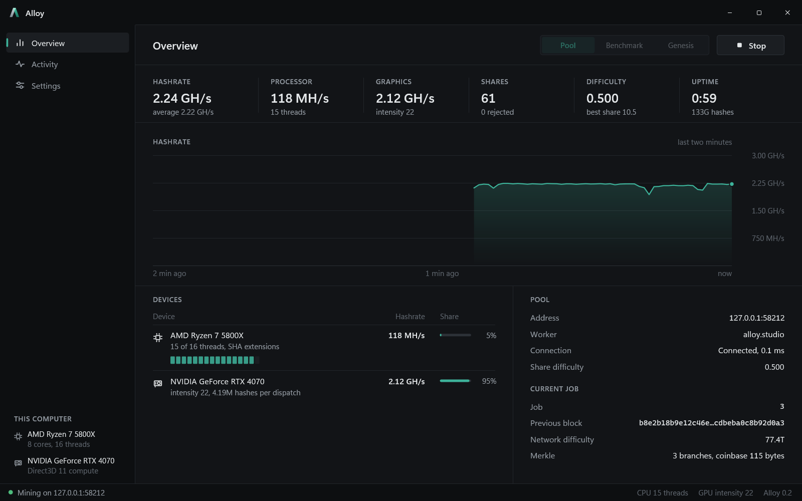
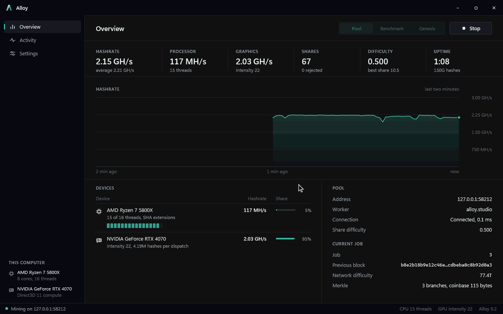

<p align="center"></p>

<h1 align="center">Alloy</h1>

<p align="center">A Bitcoin miner for Windows, written from scratch in C++ with no C runtime.</p>



Alloy mines sha256d on the processor and the graphics card at once and talks stratum to a pool. SHA-256, the stratum client, the GPU kernel, the renderer, the PNG and GIF writers and the JSON reader are all its own code. The only outside pieces are the Windows APIs underneath: Winsock, Direct3D 11, DirectComposition, Direct2D and DirectWrite.

## What it does

- **Processor mining** with a kernel built on the x86 SHA extensions, falling back to a portable one, and a midstate so each nonce costs two compressions.
- **Graphics card mining** through a compute shader dispatched with Direct3D 11. Every candidate it reports is hashed again on the processor, and a mismatch counts as a hardware error.
- **Stratum v1**: subscribe, authorize, difficulty and extranonce changes, clean jobs, stale share filtering and reconnects with backoff.
- **A test pool** (`--test-pool`) that hands out real-looking jobs and checks every share by rebuilding the coinbase, the merkle root and the header.
- **Benchmark** and **genesis** modes. Genesis searches the nonce space of block 0 and finds the nonce Satoshi found on January 3, 2009.
- **Limits** for everything that costs power: thread count, a processor usage limit, thread priority and kernel choice, plus GPU intensity and a GPU usage limit. Mining can also pause while the computer is in use or running on battery.
- **An interface** that animates at the display's refresh rate, explains a setting when you rest the cursor on it, and stops drawing entirely while minimized. The mining device runs at the lowest GPU priority, so the desktop stays smooth.


## Speed

On a Ryzen 7 5800X and an RTX 4070:

| Device | Kernel | Hashrate |
| --- | --- | --- |
| 16 threads | SHA extensions | 128 MH/s |
| 4 threads | portable | 9.7 MH/s |
| RTX 4070 | compute shader | 2.2 GH/s |
| 15 threads and the RTX 4070 | both | 2.31 GH/s |

Leaving one hardware thread free keeps the graphics card fed, so that is the default when a card is mining. The genesis search finds its nonce in about 16 seconds on the processor alone and about a second with the card.



## Building

Open `alloy.sln` in Visual Studio 2022 with the "C++ Clang tools for Windows" component and a current Windows SDK installed, then build `Release|x64`. The executable lands in `build\release\Alloy.exe`.

## Command line

```
Alloy.exe                                   open the window
Alloy.exe --bench [--seconds n]             measure the hashrate
Alloy.exe --genesis [--from nonce]          rediscover the genesis block's nonce
Alloy.exe --mine host:port [--user name] [--pass word] [--seconds n]
Alloy.exe --test-pool [--port n] [--difficulty d] [--job-seconds n]

Devices   --threads n  --no-cpu  --gpu  --no-gpu  --adapter n
Limits    --cpu-limit percent  --gpu-limit percent  --intensity 16-26
Kernel    --kernel auto|extensions|portable  --priority idle|low|normal
```

To try pool mining without an account, run `Alloy.exe --test-pool` in one terminal and point the window, or `Alloy.exe --mine 127.0.0.1:3333 --gpu`, at it.

## Layout

```
src/base     the standard library: memory, strings, text, bits, clock, threads,
             files, containers, math, JSON, PNG, GIF, clipboard and the runtime
src/hash     SHA-256, portable and with the SHA extensions
src/chain    block headers, targets and difficulty, merkle trees
src/mine     the engine that schedules nonces across threads and the GPU,
             the compute shader and its Direct3D host
src/net      sockets
src/pool     stratum jobs, the client and the test pool
src/render   the Direct2D surface for the window and for offscreen captures
src/ui       the interface: shell, pages, widgets, icons and the mark
src/app      the window, the mining session, settings and the command line
src/tests    the Debug-only test suite
```

## Tests

A Debug build runs its suite with `Alloy.exe --test`. It checks SHA-256 against the FIPS 180 vectors, the SHA extensions against the portable kernel, the genesis header, block 1 and block 100000's merkle root, the GPU kernel against the processor, a full stratum session against the test pool, the processor and GPU usage limits, and that animated text and hints land on exactly the pixels they rest on.

`Alloy.exe --smoke-window shot.png` checks the real window: the custom frame's hit testing, that animations run at the display's refresh rate while mining, and that a hidden or minimized window draws nothing so the hardware stays on mining. `Alloy.exe --capture <folder>` records the screenshots and clips above from a headless run.
