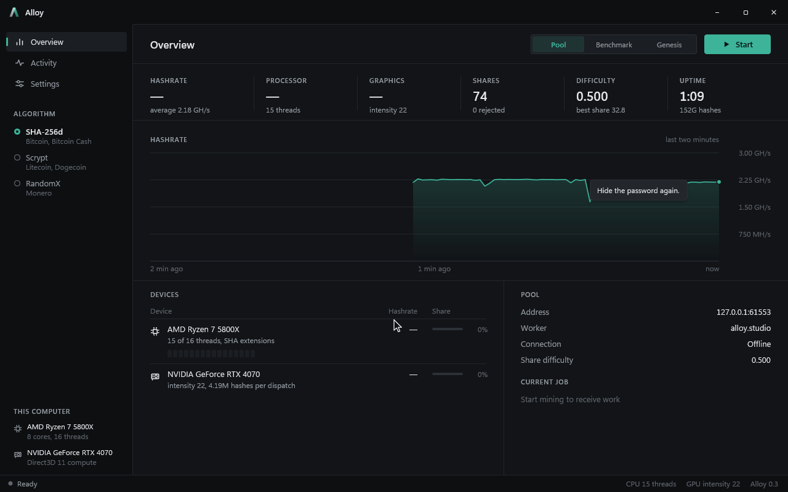

<p align="center"></p>

<h1 align="center">Alloy</h1>

<p align="center">A SHA-256d, scrypt and RandomX miner for Windows, written from scratch in C++ with no C runtime.</p>


Alloy mines Bitcoin-style SHA-256d, Litecoin-style scrypt and Monero's RandomX on the processor and the graphics card, and talks to pools over stratum or Monero's login protocol. The hashes, the RandomX virtual machine and its compiler, the pool clients, the GPU kernels, the renderer, the PNG and GIF writers and the JSON reader are all its own code. The only outside pieces are the Windows APIs underneath: Winsock, Direct3D 11, DirectComposition, Direct2D and DirectWrite.

## What it does

- **SHA-256d** on the processor with the x86 SHA extensions, falling back to a portable kernel, and on the graphics card with a compute shader that skips every round the nonce can't change.
- **Scrypt** (N 1024, r 1, p 1) on the processor with SSE2, two nonces interleaved per thread, and on the graphics card as three kernels that keep every other scratchpad block and recompute the rest, which fits 32,768 hashes in flight.
- **RandomX** with its own Argon2d, Blake2b, AES generators and SuperscalarHash. Each program is compiled to x86-64 at run time, and in full mode the whole 2048-iteration loop runs as native code. The 2 GB dataset builds in under four seconds, light mode needs only 256 MB, and the thread count follows the processor's L3 cache so scratchpads don't evict each other.
- **Pools**: stratum v1 for SHA-256d and scrypt, Monero's login, job and submit for RandomX, with stale filtering, keepalives and reconnects with backoff. Every candidate the graphics card reports is checked again on the processor.
- **A test pool** (`--test-pool`) for all three algorithms that hands out real-looking work and checks every share: it rebuilds coinbases and headers for stratum and runs RandomX itself for Monero-style jobs.
- **Benchmark** and **genesis** modes. Genesis finds the nonce in Bitcoin's block 0, or in Litecoin's with scrypt.
- **Limits** for everything that costs power: threads, a processor usage limit, priority, kernel choice, GPU intensity and a GPU usage limit, plus pausing while the computer is in use or on battery.
- **An interface** that animates at the display's refresh rate, explains a setting when you rest the cursor on it, undoes any change with Ctrl+Z, and stops drawing entirely while minimized so the hardware stays on mining.



## Speed

Release build on a Ryzen 7 5800X and an RTX 4070:

| Algorithm | Device | Hashrate |
| --- | --- | --- |
| SHA-256d | 16 threads, SHA extensions | 126 MH/s |
| SHA-256d | 15 threads and the RTX 4070 | 2.14 GH/s |
| Scrypt | 16 threads | 126 kH/s |
| Scrypt | 15 threads and the RTX 4070 | 1.46 MH/s |
| RandomX | 12 threads, full dataset | 5.07 kH/s |
| RandomX | 12 threads, light mode | 426 H/s |

Large pages usually make RandomX faster still, because the dataset reads stop missing the TLB. Windows only hands them out to accounts with the "Lock pages in memory" right, so run `Alloy.exe --allow-large-pages` once from an administrator terminal, then sign out and back in. The log says whether the dataset landed in large pages.


## Building

Open `alloy.sln` in Visual Studio 2022 with the "C++ Clang tools for Windows" component and a current Windows SDK installed, then build `Release|x64`. The executable lands in `build\release\Alloy.exe`.

## Command line

```
Alloy.exe                                   open the window
Alloy.exe --bench [algorithm] [--seconds n] measure the hashrate
Alloy.exe --genesis [--from nonce]          rediscover a genesis block's nonce
Alloy.exe --mine host:port [--user name] [--pass word] [--seconds n]
Alloy.exe --test-pool [--port n] [--difficulty d] [--job-seconds n]
Alloy.exe --allow-large-pages               let RandomX use large pages

Algorithm --algorithm sha256d|scrypt|randomx  --dataset full|light
Devices   --threads n  --no-cpu  --gpu  --no-gpu  --adapter n
Limits    --cpu-limit percent  --gpu-limit percent  --intensity 16-26
Kernel    --kernel auto|extensions|portable  --priority idle|low|normal
```

To try pool mining without an account, start a test pool in one terminal and point the window or `--mine` at it:

```
Alloy.exe --test-pool --algorithm randomx --port 3335
Alloy.exe --mine 127.0.0.1:3335 --algorithm randomx
```


## Layout

```
src/base     the standard library: memory, strings, text, bits, clock, threads,
             files, containers, sorting, math, JSON, PNG, GIF and the runtime
src/hash     SHA-256 with and without the SHA extensions, scrypt, Blake2b,
             Argon2d and the RandomX AES generators
src/chain    algorithms, block headers, targets and difficulty, merkle trees
src/randomx  SuperscalarHash, the cache and dataset, the virtual machine, an
             x86-64 assembler and the compilers built on it
src/mine     the engine that schedules nonces across threads and the GPU,
             the compute shaders and their Direct3D host
src/net      sockets
src/pool     stratum and Monero jobs, the client and the test pool
src/render   the Direct2D surface for the window and for offscreen captures
src/ui       the interface: shell, pages, widgets, icons and the mark
src/app      the window, the mining session, settings and the command line
src/tests    the Debug-only test suite
```

## Tests

A Debug build runs its suite with `Alloy.exe --test`, or one group with `--test randomx`. It checks SHA-256 against FIPS 180, scrypt and PBKDF2 against RFC 7914, Blake2b against RFC 7693, the Bitcoin and Litecoin genesis blocks, RandomX against its reference programs, dataset items and hashes in both modes, the compiled RandomX code against the interpreter, every GPU kernel against the processor, full pool sessions for all three algorithms including a RandomX seed change, the usage limits, undo, and that animated text and hints land on exactly the pixels they rest on.

`Alloy.exe --smoke-window shot.png` checks the real window: the custom frame's hit testing, that animations run at the display's refresh rate while mining, and that a hidden or minimized window draws nothing. `Alloy.exe --capture <folder>` records the screenshots and clips above from a headless run.
